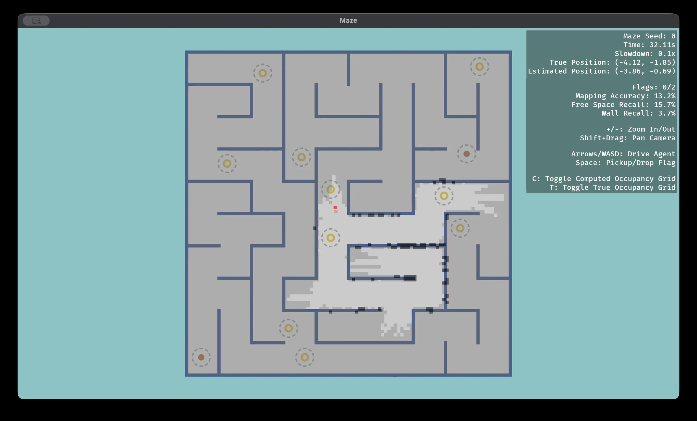

<!--
========================================================================================================================

    This is a Markdown file. If you're using VS Code, right-click the filename and select "Open Preview" to render it!

========================================================================================================================
-->

# CS 1820 Individual Programming Assignment 2: Maze

| [`README`] | [`Installation`](docs/1-installation.md#installation) | [`Game Overview`](docs/2-game-overview.md#game-overview) | [`Getting Started`](docs/3-getting-started.md#getting-started) | [`Individual Tasks`](docs/4-individual-tasks.md#individual-tasks) |
| :---: | :---: | :---: | :---: | :---: |

 

Welcome back to the CS 1820 Arcade! For this series of assignments, we’re now exploring *perception*, one of the fundamental challenges in robotics. You'll be controlling a little agent in an unfamiliar world, whose goal is to pick up flags around a maze and put them back where they belong.

In particular, you will implement two key perception modules, *localization* and *mapping*, which you will combine to create a SLAM agent. To get started, we have split this `README` into a series of Markdown files, which you can navigate through at the top. As always, we recommend reading through the entire assignment and the stencil code before you start working.

<figure style="text-align: center;">
    
</figure>

 

## Code Structure

This repository contains a couple major directories of interest.

### `configs/`

In this assignment, worlds are generated according to config YAML files, which specify the attributes of the agent and its sensors, parameters for procedural maze generation, and some GUI settings. We encourage you to inspect the default config and experiment with your own configs.

### `docs/`

In addition to the files in this `README`, we've provided a few handouts for your reference.

- `comments.md` contains documentation for important classes related to the game.

### `src/`

All code that you will be responsible for belongs here. In particular, you will be implementing various robotic policies for localization and mapping, along with two probabilistic models in the individual assignment. When designing your agents, you'll also want to make use of the `agents/utils.py`. We encourage you to create any other files, functions, and methods you need!

### `tests/`

We've provided a few tests which will benchmark the performance of your localization and mapping agents. You can play around with the number of runs and the maximum allotted time, which may be useful if your agents have non-deterministic behavior. For the individual assignment, we've also included a test which checks the equivalence of your Kalman filter and factor graph elimination implementations.

 

---

| [`Back to top`](#cs-1820-individual-programming-assignment-2-maze) | [`Installation` →](docs/1-installation.md#installation) |
| :---: | ---: |
