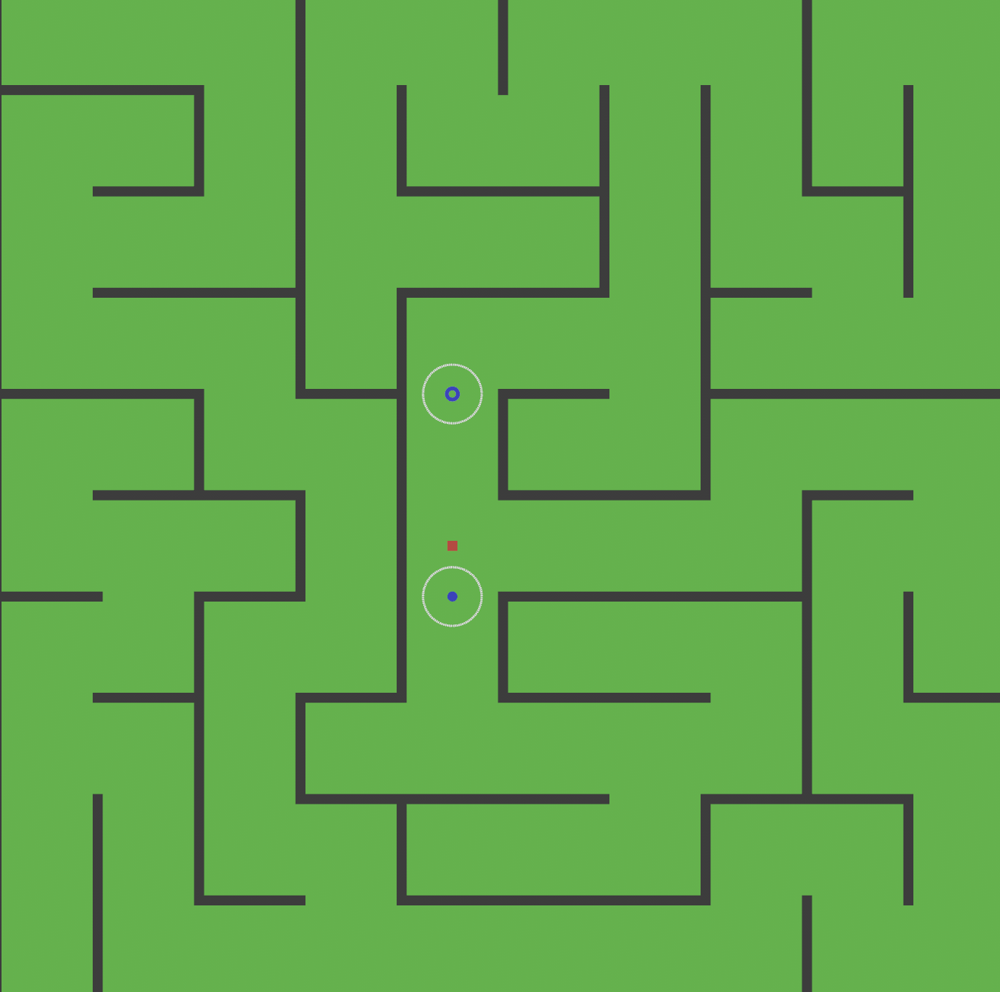
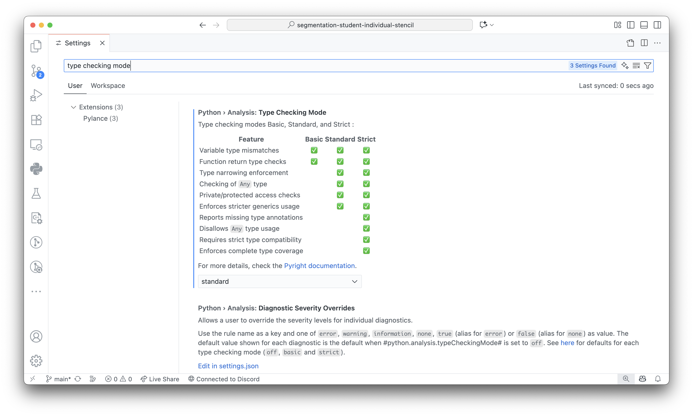
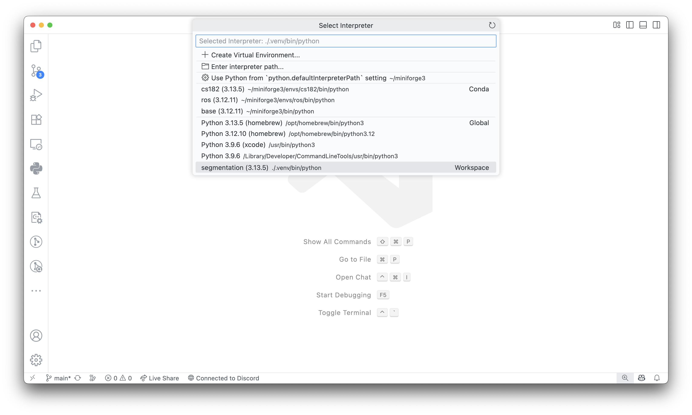

# CS182 Individual Programming Assignment 3: Maze 

Welcome back to the CS182 Arcade! Over the course of the semester we'll be taking a deeper dive into many of the topics covered in lecture through the individual and programming assignments. In particular, we will focus on how to apply the knowledge you've learned in class for agent planning and learning in games.

For this series of assignments, we’re now exploring _perception_, one of the fundamental challenges in robotics. In this programming assignment you will implement two key perception modules: Mapping and Localization within the Capture the Flag environment from the previous assignment.

As always, we highly recommend reading through the entire assignment and the stencil code before beginning with any parts of the assignment.


## Game

In the individual and group assignments, you will once again be playing Capture the Flag in a _continuous_ world. However, unlike the previous programming assignment, your agent no longer has access to perfect information about the environment. Instead, it must learn to _perceive_ its surroundings through noisy sensor data.

The goal of this assignment is to give your agent the ability to:
- Build and maintain map of the world through ray-based observations, and
- Estimate its own position within that map using a simple Kalman Filter.


### World Structure

The world remains a rectangular arena enclosed by walls with capture points and flags. The environment exposes limited information through _raycasts_ that simulate a range sensor.

Each time step, the agent receives a `GameState` that provides:
- Ray-based distance measurements to nearby obstacles,
- Its (noisy) current position and velocity,
- Limited observations of nearby entities.

You will maintain an _occupancy grid_, where each cell stores a _log-odds probability_ of being occupied. Over time, your agent should refine this grid into an accurate map of explored areas.

<div align="center">
    

</div>

## Code Structure

This repository contains two major directories of interest: `src` and `configs`:

### `src/maze/agents`

This is where your work lives! There are three agents provided in this stencil:

- `TeleopAgent`: A simple manually controlled agent that maps keyboard inputs to actions.
- `MappingAgent`: A subclass of `TeleopAgent` that updates an occupancy grid using simulated raycasts.
- `LocalizationAgent`: An agent that estimates its position using a 2D Kalman Filter.

If you have any questions about what things do/how things work please feel free to post a question on [Ed](https://edstem.org/us/courses/82550/discussion)!

### `configs`

Configuration files define parameters such as which agent to run, number of rays, and world setup. The two of most interest for this assignment are:

- `configs/mapping.yaml`
- `configs/localization.yaml`

Please feel free to create copies and modify these files as you work through the assignment to make sure things are working as expected!

## Tasks

For the individual portion of this assignment, we’ll once again be playing Capture the Flag, but this time with a focus on _perception and estimation_. By the end of this assignment, you should have an agent that is able to both map its environment and localize itself within that map. 

The first task will focus on Mapping, where your agent will use simulated range measurements to incrementally build a 2D occupancy grid representing the world.  
The second task will focus on Localization, where your agent will maintain an estimate of its own position within that map using a simple 2D Kalman Filter.

Together, these components form the foundation for autonomous perception to enable your agent to navigate a partially unknown world using uncertain sensor data.

### Task 1: Mapping

In `src/maze/agents/mapping_agent.py`, you will implement an agent that constructs a map of the environment by updating an occupancy grid using simulated sensor readings. Use the raycasts provided by the `GameState` to update the passed-in `OccupancyGrid` within the `get_action` method. Each grid cell should keep track of its _log-odds_ of being occupied.

After sufficient exploration, your occupancy grid should closely resemble the ground truth map.

#### Implementation Steps

Let's begin by taking a look at mapping. Mapping is the process of building a representation of the environment from range-based observations. In this assignment, the environment provides simulated _raycasts_ that report the distance to the nearest obstacle in several directions around the agent. Your goal is to use these readings to update a two-dimensional _occupancy grid_, where each cell maintains a log-odds estimate of being occupied.

When a ray detects a hit, increase the log-odds of the corresponding cell (making it more likely to be occupied). For all cells that the ray passes through before the hit, decrease their log-odds (marking them as free). Over time, repeated updates will allow your agent to construct an accurate map of explored regions.

Here’s the procedure at a high level:
- For each raycast:
  - Compute the cells along the ray using the agent’s current position and the ray’s angle.
  - For each cell along the ray:
    - If the cell is before the hit point, reduce its log-odds (free space).
    - If the cell corresponds to the hit, increase its log-odds (occupied).

Once you’ve implemented this logic:
- In `src/maze/agents/mapping_agent.py`, modify the `get_action` method to:
  - Call `super().get_action()` to inherit basic movement behavior.
  - Access the `GameState`'s raycast data.
  - Update the provided `OccupancyGrid` object with the new log-odds values.
- After sufficient exploration, verify that your occupancy grid visually approximates the ground truth map.


### Task 2: Localization

In `src/maze/agents/localization_agent.py`, you will implement a 2D Kalman Filter that continuously estimates the agent’s position in the arena using noisy motion and noisy observations. The estimator should maintain both an estimate of the agent’s current state and the uncertainty associated with that estimate. Your filter will use the transition mode (motion) and the sensor model (observation) introduced in lecture to recursively update its belief over time.

#### Implementation Steps

Localization is the process of determining where the agent is within the world based on imperfect motion and sensor data. In this task, you’ll implement a Kalman Filter where at each timestep, your estimator should perform two stages:

1. **Prediction:**  
   - Use the agent’s previous state and control input to predict the new position.  
   - Propagate the uncertainty forward according to the transition model.  
   - Add process noise to account for uncertainty in the motion dynamics.

2. **Correction:**  
   - When a new noisy position measurement is received from the environment (`game_state.agent.position`), use the sensor model to relate the measurement to the predicted state.  
   - Compute the Kalman gain to determine how much to trust the new measurement relative to the prediction.  
   - Update both the estimated state and covariance to refine the belief.

Once implemented:
- In `src/maze/agents/localization_agent.py`, complete the `get_action` method to:
  - Perform the prediction and correction steps on each call.  
  - Maintain and update the agent’s internal position estimate over time.  
- When visualized, your estimated trajectory should closely follow the agent’s true path, despite the noise present in both the motion and measurements.


## Installation

### `uv`

You should have `uv` installed from the previous programming assignment. If so, you should feel free to skip to [Installing Project Dependencies](#installing-project-dependencies). Otherwise, we've duplicated the instructions for installing `uv` below. We highly recommend that you use `uv` to manage your virtual environments for this course. Feel free to post on Ed or stop by office hours if you have any questions or trouble setting up your environment!

#### Installing `uv`

A headache-free way to start running the starter code is via the [`uv`](https://docs.astral.sh/uv/getting-started/installation/) package manager. To install (on Mac, Linux, WSL):

```
curl -LsSf https://astral.sh/uv/install.sh | sh
```

> [!NOTE]
> The above command requires `curl` installed! You'll most likely have this installed, already but if not it should be a small `brew/apt/pacman install` away. Alternatively, if you have `wget` already installed you can use
>
> ```
> wget -qO- https://astral.sh/uv/install.sh | sh
> ```

Alternative approaches exist to install `uv` which you are invited to explore in the [Astral documentation](https://docs.astral.sh/uv/getting-started/installation/).

#### Installing Project Dependencies

One of the major superpowers of `uv` is its ability to manage different versions of Python using a combination of virtual environments and configuration files. Initialize this project's virtual environment and install all the required dependencies by running the following command **in the root of your cloned GitHub repository**:

```
uv sync
```

> [!NOTE]
> You'll need to create a new virtual environment for each assignment!

This should install an appropriate Python version (3.13) and all the project's dependencies including `pytest`.

#### Installing the Maze Environment (Engine) - Rust
_? needed or not_

### Selecting your Python Interpreter

Using typed Python can highly improve your programming (and especially your debugging experience). To enable type checking in VSCode:

-   Open Settings (`CTRL`/`CMD` + `,`)
-   Search for `Type Checking Mode`
-   Set the mode to your desired level of strictness (`standard` is a good default!)

<div align="center">
    
</div>

To ensure that all the type stubs are resolved for your installed dependencies, you have to select the correct Python interpreter. To do so:

-   Open the Command Pallette (`CTRL`/`CMD` + `SHIFT` + `P`)
-   Type and select `Python: Select Interpreter`
-   Choose the virtual environment located in the stencil directory.

<div align="center">
    
</div>

For this to be correctly detected, be sure that the opened folder in VSCode is your cloned Github repository!

#### Running the Maze Agents

To launch and interact with any of the Maze agents, use:

```
uv run python -m maze [--help] [--config CONFIG] [--agent AGENT_ID]
```

> [!NOTE]
> Items surrounded in `[]` are optional arguments.
> `--agent` can be one of `teleop`, `mapping`, or `localization`.
> The simulation will open a window showing the maze, agent, and flags.
> 
1. The TeleopAgent allows you to control the red agent manually to explore the maze, pick up the flag, and drop it at the capture point.
2. The MappingAgent builds an internal map of the maze using simulated raycast data. It updates an occupancy grid as the agent moves through the environment.
3. The LocalizationAgent estimates the agent’s position in the maze using noisy motion and sensor data through a 2D Kalman Filter.

Some helpful commands:

```bash
# Run the Mapping Agent
uv run python -m maze --config configs/mapping.yaml --agent mapping

# Run the Localization Agent
uv run python -m maze --config configs/localization.yaml --agent localization
```

To run the provided tests (or ones you created) use:

```
uv run pytest
```

> [!NOTE]
> No sourcing required! If you prefer the virtual environment folder to not be called `.venv` then you can pass a name to the `uv venv` command. However, this would require setting the `UV_PROJECT_ENVIRONMENT` variable to this name either prior to every `uv sync` and `uv run` command, exporting the variable in every terminal session, or using some external dependency to manage your environment variables like [`direnv`](https://direnv.net/).

## Tips and Debugging

We use `pytest` to write and run tests for your assignments. `pytest` comes with a ton of handy and useful flags to help you test and debug parts of your code! Here's a list of useful flags to pass to `pytest` when debugging your assignment.

### Selecting Tests

```
pytest                      # run all tests (auto-discovery)
pytest path/                # run tests under a directory
pytest tests/test_x.py      # run tests in a file
```

### Failure Control

```
pytest -x                  # stop after first failure
pytest --maxfail=3         # stop after 3 failures
pytest --lf                # run last-failed tests only
pytest --ff                # run failures first, then the rest
pytest --sw                # stepwise: stop on first fail, resume next time
```

### Output

```
pytest -q                  # quiet (less output)
pytest -v                  # verbose (test names)
pytest -vv                 # extra verbose
pytest -s                  # don't capture stdout/stderr (show prints)
pytest -rA                 # show summary for all outcomes (reasons)
pytest -l                  # show local variables in tracebacks
pytest --tb=short          # shorter tracebacks
pytest --tb=line           # one-line tracebacks
pytest --durations=10      # show 10 slowest tests
```

### Common Combinations

```
# Fail fast with clear reasons
pytest -x -vv -rA --tb=short

# Re-run only what failed last time, show prints
pytest --lf -s -vv

# Redirecting output to a file for readability
pytest -s > foo.txt
```
