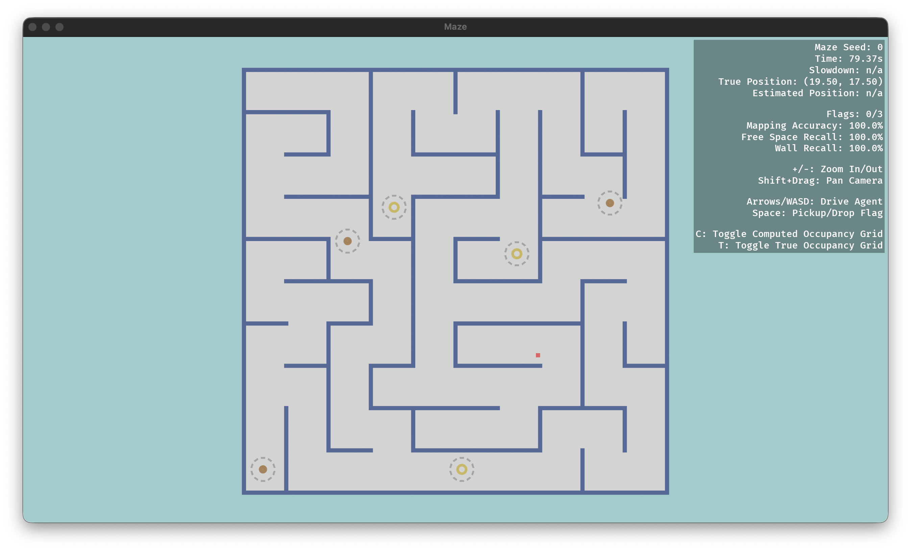

<!--
========================================================================================================================

    This is a Markdown file. If you're using VS Code, right-click the filename and select "Open Preview" to render it!

========================================================================================================================
-->

# Game Overview

| [`README`](../README.md#cs-1820-individual-programming-assignment-2-maze) | [`Installation`](1-installation.md#installation) | [`Game Overview`] | [`Getting Started`](3-getting-started.md#getting-started) | [`Individual Tasks`](4-individual-tasks.md#individual-tasks) |
| :---: | :---: | :---: | :---: | :---: |

 

In this game, you'll be piloting an agent to capture flags in a *continuous* maze. Unlike in your other assignments this semester, your agent will not have access to perfect information about the environment. Instead, it must *perceive* its surroundings through noisy sensor data. Each maze is generated according to a YAML in `configs/`, which specifies the agent's attributes, sensor parameters, and knobs for procedural maze generation. You can check out `configs/default.yaml` to get a sense for how mazes are generated.

 

## Maze Structure

Each world is a rectangular arena enclosed by walls, with flags and capture points scattered throughout the maze. Note that the origin is placed in the center of the world, with `+x` pointing to the right of the screen and `+y` pointing down. Because the world is continuous, you will have to maintain an **occupancy grid**, which acts as your agent's discrete approximation of the world.

In particular, each entry in the grid stores confidence values for that cell being a free space, a wall, a flag, or a capture point. The occupancy grid begins completely empty, but over time, your agent should refine its occupancy grid into an accurate map of explored areas. You can index it via `grid[col, row]` or `grid[(col, row)]`, with the cell at `(0, 0)` being in the upper-left corner. In the GUI, you can also visualize your agent's computed occupancy grid by pressing `C`.

<figure style="text-align: center;">
    
    <figcaption style="font-style: italic;">
        The agent is represented by a red square. Walls are shown as dark blue, while flags and capture points are given in orange and yellow, respectively.
    </figcaption>
</figure>

 

## Noisy Sensors

Your agent will not necessarily know its exact location, nor will it have fully accurate information about its environment. Stated precisely, your agent will receive noisy observations which deviate from its true position. Moreover, the environment will only expose limited information through **raycasts**, which act as range sensor readings similar to LiDAR. These are beams of light, equally spaced around the agent, which provide noisy ray-based observations to nearby objects.

<figure style="text-align: center;">
    
    <figcaption style="font-style: italic;">
        The agent is represented by a red square. Walls are shown as dark blue, while flags and capture points are given in orange and yellow, respectively.
    </figcaption>
</figure>

 

## Capturing the Flag

To control the agent, you will provide a **policy**, which periodically observes the environment and returns an action. Like an actual robot, the robot's observations and policy are tied to a discrete clock, while the actual environment runs continuously (or in this case, at 60 frames per second). At each time step, the agent receives a `GameState` and must return one of the following.

- `Action.Move(velocity)` sets the agent's velocity until the next `Move` action.
- `Action.PickupFlag()` makes the agent try to pick up a flag, holding at most one flag at a time.
- `Action.DropFlag()` makes the agent drop any flags being held.

 Note that the agent must be within a certain radius of each flag and capture point to interact. Your agent's goal is now to explore the world around it, to discover itself, and to capture all the flags.

 

---

| [← `Installation`](1-installation.md#installation) | [`Back to top`](#game-overview) | [`Getting Started` →](3-getting-started.md#getting-started) |
| :--- | :---: | ---: |
